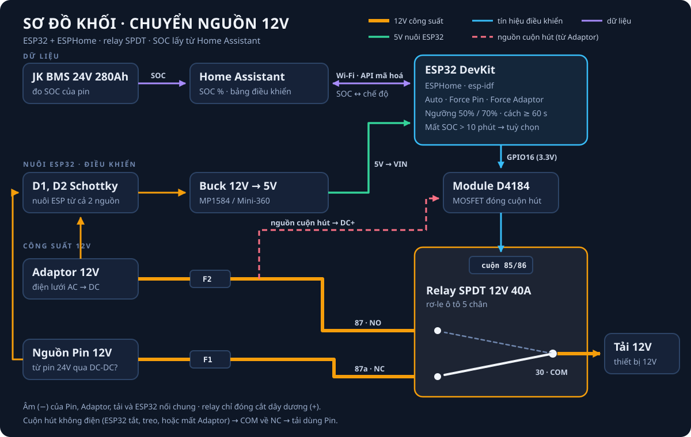
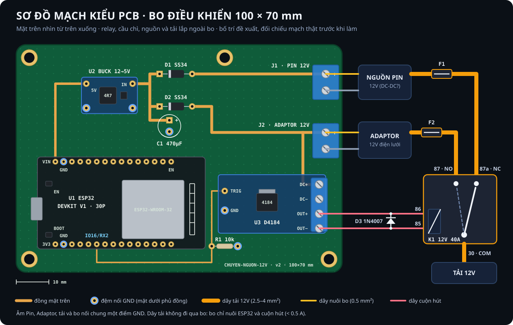

# ESP32 Auto Power Switch 12V

<!-- readme-axi type=esp32 -->

**English** · [Tiếng Việt](README.vi.md)

An **ESPHome** firmware for an **ESP32 Dev Board** that switches a 12 V load automatically between
a **battery** and a **12 V adaptor**, based on the battery's **SOC (State of Charge)** read from
**Home Assistant**. GPIO16 drives a D4184 MOSFET module, which energises the coil of the main power
relay; thresholds and the operating mode are adjustable from Home Assistant.

> 🇻🇳 Built and maintained by one person in Việt Nam — if it saves you time, please
> [support the project](#support-the-project).

## Contents

- [Features](#features)
- [Hardware](#hardware)
- [Quick start](#quick-start)
- [Configuration](#configuration)
- [How it works](#how-it-works)
- [Home Assistant](#home-assistant)
- [Troubleshooting](#troubleshooting)
- [Project layout](#project-layout)
- [Development](#development)

## Features

- **Automatic power switching** from the SOC in Home Assistant, with hysteresis against flapping
- **3 modes**: `Auto` (follows SOC), `Force Pin` (always battery), `Force Adaptor` (always adaptor)
- **Thresholds adjustable from HA and kept across reboots**
- **Lost-SOC handling**: when HA disconnects or the SOC entity has no number, after 10 minutes it
  follows the `Khi mất SOC` (when SOC is lost) choice: hold, switch to Adaptor, or back to battery
- **Relay anti-chatter**: in Auto mode, two automatic switches are at least 60 seconds apart
- **Reboots keep the relay state**, and the device does not reboot on Wi-Fi or HA loss
- **Encrypted API**, password-protected fallback Wi-Fi
- **One status line**: mode · source in use · SOC and thresholds

## Hardware

| Ref | Part | Notes |
|-----|------|-------|
| U1 | ESP32 DevKit V1 (30 pins, `esp32dev`) | GPIO16 (RX2) to the relay driver, 5V into VIN |
| U2 | MP1584 / Mini-360 buck module | Set it to exactly **5.0V** before connecting the ESP32 |
| U3 | D4184 MOSFET module | TRIG ← GPIO16, OUT+/OUT− → relay coil |
| K1 | SPDT 12V 30–40A relay (5-pin automotive) | 87a (NC) = battery, 87 (NO) = adaptor, 30 (COM) = load |
| D1, D2 | SS34 / 1N5822 Schottky diodes | Power the ESP32 from either source |
| D3 | 1N4007 | Coil flyback diode, cathode to 86 (+) |
| R1 | 10k | Pulls GPIO16 down to GND (skip if the module has one) |
| C1 | 470 µF 25V | Holds the ESP32 supply while the relay changes over |
| F1, F2 | Fuses sized for the load | One per source branch |

The coil is fed from the **adaptor**: on a mains outage the relay drops back to the battery. If the
ESP32 is off or hung, the coil is unpowered as well and the load runs from the battery.

### Block diagram



### PCB-style layout

A 100 × 70 mm control board, two layers (bottom copper pour is GND). Relay, fuses, sources and load
are mounted off-board; load current never goes through the board. This is a suggested layout: check
the ESP32 DevKit and D4184 module pinouts against your actual parts before building.



## Quick start

### 1. Prepare the environment

```bash
# Install ESPHome
pip install esphome

# Clone repository
git clone https://github.com/ngoviet/esp32-auto-power-switch-12v.git
cd esp32-auto-power-switch-12v
```

### 2. Configure WiFi and security

```bash
# Create the secrets file from the template
cp secrets.yaml.example secrets.yaml
```

Edit `secrets.yaml`; all 5 keys are required:

```yaml
wifi_ssid: "YOUR_WIFI"
wifi_password: "YOUR_WIFI_PASSWORD"
ota_password: "over_the_air_password"
ap_password: "fallback_wifi_password"     # at least 8 characters
api_encryption_key: "..."                 # 32-byte base64, see secrets.yaml.example
```

> ⚠️ **Important**: `secrets.yaml` exists only locally and must NEVER be pushed to GitHub!

### 3. Customise the configuration

- **SOC Entity**: change `battery_soc_entity` in `substitutions` (default `sensor.tang_3_24v280ah_remaining_capacity`)
- **GPIO Pin**: change `relay_pin` if it is not GPIO16
- **SOC thresholds**: change `soc_switch_to_adapter_default` and `soc_switch_to_battery_default`

### 4. Flash the firmware to the ESP32

```bash
# Option 1: ESPHome CLI
esphome run esp32_chuyen_nguon_12v.yaml

# Option 2: Windows script (network by default; first flash over USB: flash.bat COM12)
flash.bat

# Option 3: ESPHome Dashboard
esphome dashboard .
```

Add the device to Home Assistant (ESPHome integration) and paste `api_encryption_key` when asked.

## Configuration

| Setting | Default | Adjustable |
|---------|---------|------------|
| Switch to Adaptor | SOC < 50% | ✅ From HA (20–60%) |
| Switch back to Battery | SOC > 70% | ✅ From HA (60–90%) |
| When SOC is lost | Hold | ✅ From HA |
| Wait before applying "when SOC is lost" | 10 minutes | `soc_lost_delay_s` |
| Minimum gap between automatic switches | 60 seconds | `min_switch_gap_s` |
| GPIO Relay | GPIO16 | `relay_pin` |
| SOC Entity | `sensor.tang_3_24v280ah_remaining_capacity` | `battery_soc_entity` |

## How it works

### Auto mode

```
SOC < 50%        → switch to Adaptor (let the battery rest and recharge)
50% ≤ SOC ≤ 70%  → keep the current state (hysteresis)
SOC > 70%        → switch back to Battery (battery preferred)
```

The logic runs as soon as the SOC, a threshold or the mode changes, and again every 5 seconds.

### Manual mode

- **Force Pin**: always use the battery (ignores SOC)
- **Force Adaptor**: always use the adaptor (ignores SOC; on a mains outage the relay still drops back to the battery)

### When SOC is lost

The SOC is trusted only while HA is connected and the entity holds a number. HA sends a value only
when it changes, so after a disconnect the last number may be stale. After 10 minutes without SOC,
Auto mode follows the `Khi mất SOC` choice.

## Home Assistant

After flashing and adding it to HA, the **Chuyển nguồn 12V** device has these entities (HA derives
the entity_id from the device name, usually as below):

### Controls

- **`select.chuyen_nguon_12v_che_do_chuyen_nguon`**: Auto / Force Pin / Force Adaptor
- **`select.chuyen_nguon_12v_khi_mat_soc`**: hold / switch to Adaptor / back to battery
- **`number.chuyen_nguon_12v_nguong_chuyen_sang_adaptor`**: threshold for switching to the Adaptor (20–60%)
- **`number.chuyen_nguon_12v_nguong_chuyen_ve_pin`**: threshold for switching back to the Battery (60–90%)

### Monitoring

- **`binary_sensor.chuyen_nguon_12v_dang_dung_adaptor`**: current power source
- **`binary_sensor.chuyen_nguon_12v_soc_hop_le`**: whether the ESP32 is receiving the SOC
- **`sensor.chuyen_nguon_12v_trang_thai`**: mode · source · SOC and thresholds
- **`sensor.chuyen_nguon_12v_ly_do_khoi_dong_lai`**: reset reason, catches brownouts when the relay switches

## Troubleshooting

### No SOC received from HA

1. Check that the entity in `battery_soc_entity` exists in HA and its unit is `%`
2. Check that the ESP32 has been added to HA and is connected (`SOC hợp lệ` is on)
3. View the log: `log.bat` or `esphome logs esp32_chuyen_nguon_12v.yaml`

### Relay does not work

1. Check the wiring GPIO16 → TRIG of the D4184, ESP32 GND to module GND
2. Check 12V on DC+/DC− of the D4184 (taken from the adaptor)
3. Try `Force Adaptor`: the relay must pull in and `Đang dùng Adaptor` turns on

### ESP32 reboots when the relay switches

1. Look at `Lý do khởi động lại` (reset reason): `Brownout` means the supply sagged
2. Check D3 (coil flyback diode) and C1
3. Check that the buck module is set to 5.0V

### WiFi does not connect

1. Check `secrets.yaml` — are the SSID/password correct?
2. Make sure the ESP32 is within WiFi range
3. Without a network the ESP32 opens the `chuyen-nguon-12v` Wi-Fi (password `ap_password`)

### Getting help

If you run into a problem, please open an
[issue](https://github.com/ngoviet/esp32-auto-power-switch-12v/issues) on this GitHub repository.

## Project layout

```
esp32_chuyen_nguon_12v/
├── esp32_chuyen_nguon_12v.yaml   # Main config: relay, modes, thresholds, switching logic
├── base_setup.yaml               # Shared part: API, OTA, Wi-Fi, diagnostic sensors
├── secrets.yaml.example          # Secrets template (5 keys)
├── docs/
│   ├── so-do-khoi.svg            # Block diagram
│   └── so-do-pcb.svg             # PCB-style layout
├── flash.bat                     # Flash firmware (IP or COM port)
├── log.bat                       # View logs
└── erase.bat                     # Erase flash over USB
```

## Development

### Automated checks

Every PR that touches the config runs the `ESPHome` workflow on GitHub Actions: `esphome config`,
then a firmware build, with fake secrets generated from `secrets.yaml.example`. When the YAML gains
a new `!secret`, add that key to `secrets.yaml.example` too, or CI turns red.

### Contributing

All contributions are welcome! Please open an Issue or a Pull Request.

<!-- support:start -->
## Support the project

<p align="center">
  
</p>

<p align="center">Free and open source. Your support pays for new device support, faster fixes and every release.</p>

<p align="center">
  <a href="https://buymeacoffee.com/ngoviet"></a>
  &nbsp;
  <a href="https://github.com/sponsors/ngoviet"></a>
</p>

<p align="center">
  
  &nbsp;
  
</p>

<p align="center"><b>Crypto wallet, BNB Smart Chain (BEP20) only:</b><br><code>0xcbf0402b232cb24b4d998f09a4884f87b5f74750</code></p>

<p align="center">🇻🇳 VietQR: scan with any Vietnamese banking app, transfer note <code>Ung ho esp32-auto-power-switch-12v</code>. Thank you for keeping this project alive!</p>
<!-- support:end -->

## License

[MIT](LICENSE) © Ngô Đức Việt.
