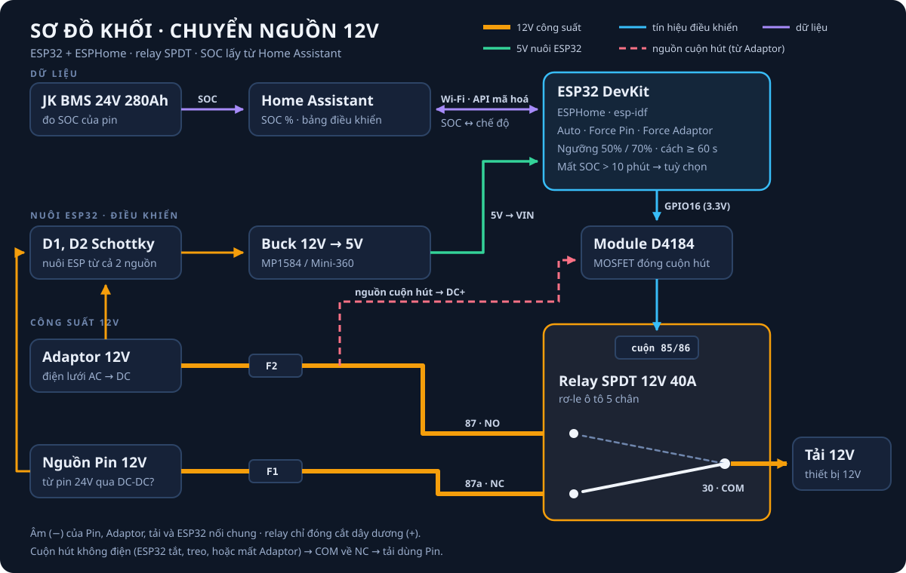
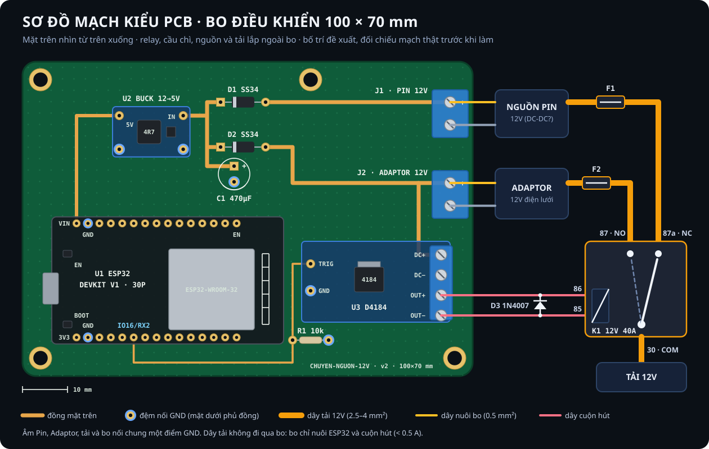

# ESP32 chuyển nguồn tự động 12V

<!-- readme-axi type=esp32 -->

[English](README.md) · **Tiếng Việt**

Firmware **ESPHome** cho **ESP32 Dev Board**, tự động chuyển nguồn 12V cho tải giữa **Pin** và
**Adaptor 12V** dựa trên **SOC (State of Charge)** của pin lấy từ **Home Assistant**. GPIO16 điều
khiển module MOSFET D4184, module này đóng cuộn hút của relay nguồn chính; ngưỡng và chế độ hoạt
động chỉnh được ngay trên Home Assistant.

> 🇻🇳 Dự án do một người Việt tự xây dựng và duy trì — nếu nó giúp ích cho bạn, hãy
> [ủng hộ dự án](#ủng-hộ-dự-án).

## Mục lục

- [Tính năng](#tính-năng)
- [Phần cứng](#phần-cứng)
- [Bắt đầu nhanh](#bắt-đầu-nhanh)
- [Cấu hình](#cấu-hình)
- [Cách hoạt động](#cách-hoạt-động)
- [Home Assistant](#home-assistant)
- [Xử lý sự cố](#xử-lý-sự-cố)
- [Cấu trúc dự án](#cấu-trúc-dự-án)
- [Phát triển](#phát-triển)

## Tính năng

- **Chuyển nguồn tự động** theo SOC lấy từ Home Assistant, có vùng trễ (hysteresis) chống dao động
- **3 chế độ**: `Auto` (theo SOC), `Force Pin` (luôn dùng Pin), `Force Adaptor` (luôn dùng Adaptor)
- **Ngưỡng chỉnh từ HA và nhớ qua khởi động lại**
- **Xử lý mất SOC**: khi HA mất kết nối hoặc entity SOC không có số, sau 10 phút làm theo lựa chọn
  `Khi mất SOC` (giữ nguyên, chuyển sang Adaptor, hoặc về Pin)
- **Chống nhấp nhả relay**: ở chế độ Auto, hai lần tự chuyển cách nhau ít nhất 60 giây
- **Khởi động lại không làm mất trạng thái relay**, không tự khởi động lại khi mất Wi-Fi hay HA
- **API mã hoá**, Wi-Fi dự phòng có mật khẩu
- **Một dòng trạng thái**: chế độ · nguồn đang dùng · SOC và ngưỡng

## Phần cứng

| Ký hiệu | Linh kiện | Ghi chú |
|---------|-----------|---------|
| U1 | ESP32 DevKit V1 (30 chân, `esp32dev`) | GPIO16 (RX2) ra relay, nuôi 5V qua VIN |
| U2 | Module hạ áp MP1584 / Mini-360 | Chỉnh đúng **5.0V** trước khi nối ESP32 |
| U3 | Module MOSFET D4184 | TRIG ← GPIO16, OUT+/OUT− → cuộn hút relay |
| K1 | Relay SPDT 12V 30–40A (rơ-le ô tô 5 chân) | 87a (NC) = Pin, 87 (NO) = Adaptor, 30 (COM) = tải |
| D1, D2 | Diode Schottky SS34 / 1N5822 | Nuôi ESP32 từ cả hai nguồn |
| D3 | 1N4007 | Chống điện áp ngược cuộn hút, catot về 86 (+) |
| R1 | 10k | Kéo GPIO16 xuống GND (bỏ nếu module đã có) |
| C1 | 470 µF 25V | Giữ áp cho ESP32 lúc relay đảo tiếp điểm |
| F1, F2 | Cầu chì theo dòng tải | Một cái cho mỗi nhánh nguồn |

Cuộn hút lấy điện từ **Adaptor**: mất điện lưới thì relay tự nhả về Pin. ESP32 tắt hoặc treo thì
cuộn hút cũng không có điện, tải dùng Pin.

### Sơ đồ khối



### Sơ đồ mạch kiểu PCB

Bo điều khiển 100 × 70 mm, hai lớp (mặt dưới phủ đồng làm GND). Relay, cầu chì, nguồn và tải lắp
ngoài bo, dây tải không đi qua bo. Đây là bố trí đề xuất: đối chiếu chân ESP32 DevKit và module
D4184 với linh kiện thật trước khi làm.



## Bắt đầu nhanh

### 1. Chuẩn bị môi trường

```bash
# Cài đặt ESPHome
pip install esphome

# Clone repository
git clone https://github.com/ngoviet/esp32-auto-power-switch-12v.git
cd esp32-auto-power-switch-12v
```

### 2. Cấu hình WiFi và bảo mật

```bash
# Tạo file secrets từ template
cp secrets.yaml.example secrets.yaml
```

Sửa file `secrets.yaml`, cả 5 khoá đều bắt buộc:

```yaml
wifi_ssid: "TEN_WIFI_CUA_BAN"
wifi_password: "MAT_KHAU_WIFI"
ota_password: "mat_khau_nap_qua_mang"
ap_password: "mat_khau_wifi_du_phong"     # tối thiểu 8 ký tự
api_encryption_key: "..."                 # 32 byte base64, cách tạo ghi trong secrets.yaml.example
```

> ⚠️ **Quan trọng**: File `secrets.yaml` chỉ tồn tại local, KHÔNG bao giờ được push lên GitHub!

### 3. Tùy chỉnh cấu hình

- **SOC Entity**: sửa `battery_soc_entity` trong `substitutions` (mặc định `sensor.tang_3_24v280ah_remaining_capacity`)
- **GPIO Pin**: sửa `relay_pin` nếu khác GPIO16
- **Ngưỡng SOC**: sửa `soc_switch_to_adapter_default` và `soc_switch_to_battery_default`

### 4. Flash firmware lên ESP32

```bash
# Cách 1: ESPHome CLI
esphome run esp32_chuyen_nguon_12v.yaml

# Cách 2: Script Windows (mặc định qua mạng; lần đầu qua USB: flash.bat COM12)
flash.bat

# Cách 3: ESPHome Dashboard
esphome dashboard .
```

Thêm thiết bị vào Home Assistant (ESPHome integration), dán `api_encryption_key` khi HA hỏi khoá.

## Cấu hình

| Thông số | Mặc định | Điều chỉnh |
|----------|----------|------------|
| Chuyển sang Adaptor | SOC < 50% | ✅ Từ HA (20–60%) |
| Chuyển về Pin | SOC > 70% | ✅ Từ HA (60–90%) |
| Khi mất SOC | Giữ nguyên | ✅ Từ HA |
| Chờ trước khi áp "Khi mất SOC" | 10 phút | `soc_lost_delay_s` |
| Khoảng cách tối thiểu giữa hai lần tự chuyển | 60 giây | `min_switch_gap_s` |
| GPIO Relay | GPIO16 | `relay_pin` |
| SOC Entity | `sensor.tang_3_24v280ah_remaining_capacity` | `battery_soc_entity` |

## Cách hoạt động

### Chế độ Auto

```
SOC < 50%        → chuyển sang Adaptor (để pin nghỉ, sạc lại)
50% ≤ SOC ≤ 70%  → giữ nguyên (vùng trễ)
SOC > 70%        → về Pin (ưu tiên pin)
```

Logic chạy ngay khi SOC, ngưỡng hay chế độ thay đổi, và chạy lại mỗi 5 giây.

### Chế độ Manual

- **Force Pin**: luôn dùng pin (bỏ qua SOC)
- **Force Adaptor**: luôn dùng adaptor (bỏ qua SOC; mất điện lưới thì relay vẫn tự về Pin)

### Khi mất SOC

SOC chỉ được tin khi HA đang kết nối và entity có số. HA chỉ gửi giá trị khi nó đổi, nên lúc mất
kết nối thì con số cuối cùng có thể đã cũ. Mất SOC quá 10 phút, chế độ Auto làm theo lựa chọn
`Khi mất SOC`.

## Home Assistant

Sau khi flash và thêm vào HA, thiết bị **Chuyển nguồn 12V** có các entity (HA đặt entity_id theo
tên thiết bị, thường như dưới đây):

### Điều khiển

- **`select.chuyen_nguon_12v_che_do_chuyen_nguon`**: Auto / Force Pin / Force Adaptor
- **`select.chuyen_nguon_12v_khi_mat_soc`**: giữ nguyên / chuyển sang Adaptor / chuyển về Pin
- **`number.chuyen_nguon_12v_nguong_chuyen_sang_adaptor`**: ngưỡng chuyển Adaptor (20–60%)
- **`number.chuyen_nguon_12v_nguong_chuyen_ve_pin`**: ngưỡng chuyển Pin (60–90%)

### Giám sát

- **`binary_sensor.chuyen_nguon_12v_dang_dung_adaptor`**: nguồn đang dùng
- **`binary_sensor.chuyen_nguon_12v_soc_hop_le`**: ESP32 có đang nhận SOC hay không
- **`sensor.chuyen_nguon_12v_trang_thai`**: chế độ · nguồn · SOC và ngưỡng
- **`sensor.chuyen_nguon_12v_ly_do_khoi_dong_lai`**: bắt sụt áp (brownout) khi relay đóng cắt

## Xử lý sự cố

### Không nhận SOC từ HA

1. Kiểm tra entity trong `battery_soc_entity` có trong HA và đơn vị là `%`
2. ESP32 đã được thêm vào HA và đang kết nối (`SOC hợp lệ` = bật)
3. Xem log: `log.bat` hoặc `esphome logs esp32_chuyen_nguon_12v.yaml`

### Relay không hoạt động

1. Kiểm tra dây GPIO16 → TRIG của D4184, GND ESP32 nối GND module
2. Kiểm tra 12V vào DC+/DC− của D4184 (lấy từ Adaptor)
3. Thử chế độ `Force Adaptor`: relay phải đóng, `Đang dùng Adaptor` = bật

### ESP32 khởi động lại khi relay đóng cắt

1. Xem `Lý do khởi động lại`: `Brownout` nghĩa là sụt áp
2. Kiểm tra D3 (chống điện áp ngược cuộn hút) và C1
3. Kiểm tra mạch hạ áp đã chỉnh đúng 5.0V

### WiFi không kết nối

1. Kiểm tra `secrets.yaml` - SSID/password đúng chưa
2. Đảm bảo ESP32 trong vùng phủ sóng WiFi
3. Không vào được mạng thì ESP32 phát Wi-Fi `chuyen-nguon-12v` (mật khẩu `ap_password`)

### Cần hỗ trợ

Nếu gặp vấn đề, vui lòng tạo
[Issue](https://github.com/ngoviet/esp32-auto-power-switch-12v/issues) trên GitHub repository này.

## Cấu trúc dự án

```
esp32_chuyen_nguon_12v/
├── esp32_chuyen_nguon_12v.yaml   # Cấu hình chính: relay, chế độ, ngưỡng, logic chuyển nguồn
├── base_setup.yaml               # Phần chung: API, OTA, Wi-Fi, cảm biến chẩn đoán
├── secrets.yaml.example          # Mẫu secrets (5 khoá)
├── docs/
│   ├── so-do-khoi.svg            # Sơ đồ khối
│   └── so-do-pcb.svg             # Sơ đồ mạch kiểu PCB
├── flash.bat                     # Nạp firmware (IP hoặc cổng COM)
├── log.bat                       # Xem log
└── erase.bat                     # Xoá sạch flash qua USB
```

## Phát triển

### Đóng góp

Mọi đóng góp đều được chào đón! Vui lòng tạo Issue hoặc Pull Request.

<!-- support:start -->
## Ủng hộ dự án

<p align="center">
  
</p>

<p align="center">Một người Việt tự xây dựng và duy trì, miễn phí và mã nguồn mở. Sự ủng hộ của bạn giúp hỗ trợ thêm thiết bị, sửa lỗi nhanh hơn và ra bản mới đều đặn.</p>

<p align="center">
  <a href="https://buymeacoffee.com/ngoviet"></a>
  &nbsp;
  <a href="https://github.com/sponsors/ngoviet"></a>
</p>

<p align="center">
  
  &nbsp;
  
</p>

<p align="center"><b>Ví tiền mã hoá, chỉ gửi qua mạng BNB Smart Chain (BEP20):</b><br><code>0xcbf0402b232cb24b4d998f09a4884f87b5f74750</code></p>

<p align="center">🇻🇳 VietQR: quét bằng app ngân hàng bất kỳ, nội dung <code>Ung ho esp32-auto-power-switch-12v</code>. Cảm ơn bạn đã giúp dự án tiếp tục phát triển!</p>
<!-- support:end -->

## Giấy phép

[MIT](LICENSE) © Ngô Đức Việt.
